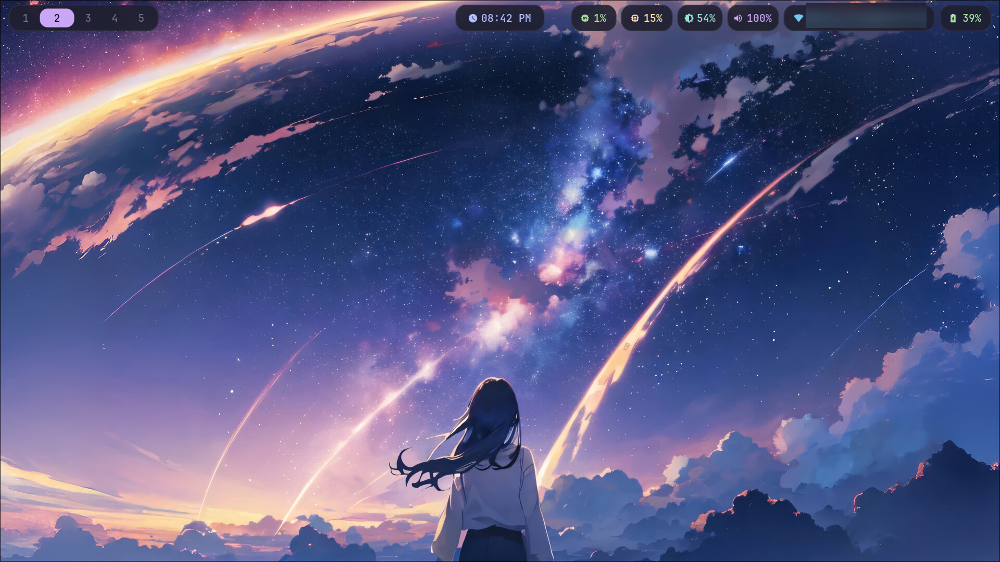

# Arch Hyprland Boilerplate

A deliberately minimal [Hyprland](https://hyprland.org/) setup for Arch Linux, themed with
[Catppuccin Mocha](https://catppuccin.com/palette). Small enough to read top to bottom in a
few minutes, then build on — not a full rice.

On top of that core sits an optional **video wallpaper** layer, which can also play anime
episodes as the desktop background. It lives in its own scripts and falls back to a plain static
wallpaper when its tools aren't installed, so the core works the same without it.



<sub>Wallpaper not included. The network name in the bar is blurred in this shot.</sub>

New to Arch, Hyprland, or ricing generally? **[LEARNING.md](LEARNING.md)** maps every file to
what it controls and points at the actual docs behind this setup, not just this README.

## What's here

- **Hyprland** — rounded corners, blur, shadows, and two custom animation curves
- **Waybar** — the bar itself is invisible; each module is its own floating frosted pill
- **wofi** — centered translucent launcher with fuzzy matching and app icons
- **Lock screen and idle** — hyprlock and hypridle, themed to match, plus a session menu in the bar
- One palette, defined once per stylesheet as `@define-color` — swap the accent in a single place

Optional:

- **[Video wallpaper](#video-wallpaper-optional)** — [mpvpaper](https://github.com/GhostNaN/mpvpaper)
  loops a video behind your windows, with the static image as an automatic fallback
- **[Anime on the wallpaper](#anime-on-the-wallpaper-optional)** — episodes play as the desktop
  background, with subtitles, auto-advancing through a range and resuming where you stopped

```
hypr/hyprland.conf            compositor: monitors, decoration, animations, binds
hypr/hyprlock.conf            lock screen
hypr/hypridle.conf            idle timeouts: dim -> lock -> screen off
waybar/config                 bar layout and modules
waybar/style.css              bar theming (palette lives at the top)
wofi/config                   launcher behavior and geometry
wofi/style.css                launcher theming
scripts/screenshot.sh         grim/slurp wrapper (region/screen, copy/save)
scripts/wifi-menu.sh          wofi + nmcli Wi-Fi picker, opened by the network pill
scripts/power-menu.sh         wofi session menu, opened by the power pill

scripts/wallpaper-start       bring up the video wallpaper (mpvpaper)
scripts/mpvpaper-ipc          talk to it over mpv's JSON IPC socket
scripts/wallpaper-audio       mute the wallpaper only — the bar toggle and SUPER+SHIFT+A
scripts/wallpaper-lock-watch  pause the wallpaper while locked or asleep
scripts/watch-anime           play anime on the wallpaper through ani-cli
scripts/mpvpaper-feed         ...its player shim
scripts/watch-anime-anipy     the same, through anipy-cli
scripts/anipy-feed            ...its player shim (anipy-player/mpv links to it)
scripts/wallpaper-resume      pick the last episode back up where it stopped
anipy-wallpaper/              anipy-cli config used only in wallpaper mode
```

## Dependencies

```bash
sudo pacman -S hyprland waybar wofi kitty awww ttf-jetbrains-mono-nerd grim slurp wl-clipboard
```

`grim` + `slurp` + `wl-clipboard` back the screenshot binds and `scripts/screenshot.sh` —
core here because a screenshot key is table stakes for a usable desktop.

The Waybar volume module and the volume keys use `wpctl`, so it also expects PipeWire:

```bash
sudo pacman -S pipewire pipewire-pulse wireplumber
```

### Optional

Everything below is optional — the setup works without it, but these binds and click actions stay
inert until the matching tool is present.

```bash
sudo pacman -S networkmanager            # Wi-Fi picker on the network pill (nmcli)
sudo pacman -S playerctl                 # play/pause/next/prev media keys
sudo pacman -S brightnessctl             # brightness keys + hypridle's dim step (the bar slider needs nothing)
sudo pacman -S hyprlock hypridle         # lock screen + idle timeouts
```

`networkmanager` must also be enabled: `sudo systemctl enable --now NetworkManager`.

The video wallpaper and anime extras have their own install steps, in their sections below.

### A note on `awww` (formerly `swww`)

Upstream renamed the wallpaper daemon `swww` → `awww` in October 2025 and moved from GitHub to
[Codeberg](https://codeberg.org/LGFae/awww). Same project, same author, continuing version line.

On Arch, `pacman -S swww` still resolves — the `awww` package declares `Provides: swww` and
`Replaces: swww` — but **the binaries are `awww` and `awww-daemon`**, not `swww`/`swww-daemon`.
Configs and scripts written against the old names fail silently. This repo uses the new names.

## Install

These files map directly onto `~/.config`. Back up anything you already have:

```bash
cp -r ~/.config/hypr ~/.config/hypr.bak     # repeat for waybar, wofi
cp -r hypr waybar wofi scripts anipy-wallpaper ~/.config/
chmod +x ~/.config/scripts/*
```

Then drop a wallpaper at `~/Pictures/wallpaper.jpg`. With mpvpaper installed you can also put a
video at `~/Videos/wallpaper.mp4`, which takes priority. Both paths are hardcoded, in
`scripts/wallpaper-start` and the `--- wallpaper ---` block of `hypr/hyprland.conf` — if neither
file is there, Hyprland starts fine but the background stays black.

## Keybindings

| Combo | Action |
| --- | --- |
| `SUPER + Return` | Terminal (kitty) |
| `SUPER + D` | App launcher (wofi) |
| `SUPER + Q` | Close focused window |
| `SUPER + F` | Toggle fullscreen |
| `SUPER + V` | Toggle floating |
| `SUPER + SHIFT + L` | Lock the screen |
| `SUPER + SHIFT + E` | Exit Hyprland |

**Workspaces**

| Combo | Action |
| --- | --- |
| `SUPER + 1`…`5` | Switch to workspace |
| `SUPER + SHIFT + 1`…`5` | Send focused window to workspace |
| `SUPER + scroll` | Cycle workspaces |

Capped at 5 to match `persistent-workspaces` in `waybar/config` — extend both together if you
want more. You can also click the pills in the bar.

**Windows**

| Combo | Action |
| --- | --- |
| `SUPER + ←↑↓→` or `H/J/K/L` | Move focus |
| `SUPER + SHIFT + ←↑↓→` | Move window within the layout |
| `SUPER + CTRL + ←↑↓→` | Resize window |
| `SUPER + drag` / `SUPER + right-drag` | Move / resize with the mouse |
| `SUPER + M` | Stash the focused window (hide without closing) |
| `SUPER + SHIFT + M` | Show / hide the stash (overlaid on the current workspace) |
| `SUPER + CTRL + M` | Pull the focused window out of the stash onto the current workspace |

Hyprland has no minimize. `SUPER + M` sends a window to the **special workspace** (a scratchpad).
`SUPER + SHIFT + M` toggles that workspace into view *over* whatever you're on — the stashed
windows float above your layout, they don't join it. To put one back into the tiling layout
beside your open windows: reveal the stash, focus the window you want (`SUPER + arrow` or click),
then `SUPER + CTRL + M`. Repeat to empty the stash entirely.

Multiple stashed windows tile among themselves while revealed. A minimize glyph appears in the
bar's workspace list whenever anything is stashed — that's your only cue it's there.

**Media and screenshots** — the screenshot keys need `grim`/`slurp`/`wl-clipboard` (in the core
deps line); the rest need the optional packages above.

| Combo | Action |
| --- | --- |
| `Print` | Whole screen to clipboard |
| `SUPER + S` | Select a region to clipboard |
| `SUPER + SHIFT + S` | Select a region to clipboard **and** `~/Pictures/Screenshots/` |
| Volume / mute / mic keys | via `wpctl` |
| Play / next / previous | via `playerctl` |
| Brightness keys | via `brightnessctl` |

**Video wallpaper and anime** — the wallpaper can't take keyboard focus, so these reach it
through mpv's IPC socket instead. They do nothing when mpvpaper isn't running.

| Combo | Action |
| --- | --- |
| `SUPER + P` | Pause / resume the wallpaper |
| `SUPER + [` / `SUPER + ]` | Seek back / forward 10 seconds |
| `SUPER + SHIFT + A` | Mute / unmute the wallpaper only, not the whole system |
| `SUPER + A` | Pick an anime to play on the wallpaper (ani-cli, in kitty) |
| `SUPER + R` | Resume the last episode where it stopped |

## The bar is interactive

| Module | Hover | Click |
| --- | --- | --- |
| Workspaces | — | Switch to it |
| Clock | Month calendar | Toggle time ⇄ date |
| CPU | Usage + load average | — |
| RAM | Used / total / available | — |
| Brightness | Level | **Slides out a drag bar** (scroll also works) |
| Volume | Device + level | **Slides out a drag bar**; scroll adjusts; revealed buttons mute the system and (teal) the wallpaper only |
| Network | SSID, signal, IP | **Wi-Fi picker** (`scripts/wifi-menu.sh` — wofi + nmcli) |
| Battery | Charge + time remaining | — |
| Power | What the menu offers | **Session menu** (`scripts/power-menu.sh`) — lock, switch user, log out, suspend, reboot, power off |

Brightness and volume use Waybar's native `backlight/slider` and `pulseaudio/slider` inside a
click-to-reveal `group` drawer. Both write through system APIs Waybar is already linked against
(logind for brightness, PipeWire for volume) — **no `brightnessctl`, `wpctl`, or `video` group
needed** for the bar. Those tools are still listed as optional because the *keybindings* use them.

The brightness slider floors at 5% so a full drag left can't black out the screen. The clock is
12-hour (`%I:%M %p`) — change it to `{:%H:%M}` in `waybar/config` for 24-hour.

## Scripts

Three helpers in `scripts/`, called by the binds and the bar. All degrade quietly if their tools
aren't installed. The wallpaper scripts are covered in their own sections below.

**`screenshot.sh`** — `grim` + `slurp`, with `wl-copy` to the clipboard and an optional file
copy. `notify-send` is best-effort, so no notification daemon just means no popup.

**`wifi-menu.sh`** — a `wofi` list of nearby networks via `nmcli`: signal glyph, lock marker, a
check on the active one. Picking a saved network reconnects; a new secured one prompts for a
password in a `wofi --password` box. Also has rescan and a Wi-Fi on/off toggle. It reuses
`wofi/style.css`, so it's themed with no extra config. Needs `networkmanager` running; for
editing static/VPN/enterprise connections, `nm-connection-editor` is the GUI.

**`power-menu.sh`** — the session menu behind the power pill, in the same wofi style. Log out,
reboot, and power off ask for a second confirmation; lock, suspend, and switch user don't, since
they're easy to undo. **Switch User** asks GDM for a fresh login screen over D-Bus, so it only
works under GDM (it locks this session first, so your desktop isn't left open on another VT).

## Lock screen and idle

`hyprlock` blurs a screenshot of the desktop for its background, so the lock screen matches
whatever the wallpaper was showing. `hypridle` dims the screen after 4 minutes idle, locks at 5,
and turns the display off at 5½ — change the timeouts in `hypr/hypridle.conf`. The dim step needs
`brightnessctl`.

`SUPER + SHIFT + L`, the power menu, and hypridle all lock with `loginctl lock-session` rather than
running `hyprlock` directly. That's deliberate: going through logind emits a Lock signal, which
`scripts/wallpaper-lock-watch` uses to pause the video wallpaper while you're away, and to resume
it when you unlock. Suspend and wake work the same way. It only resumes what it paused, so a
wallpaper you paused yourself stays paused.

To try a hyprlock config without risking a lock screen you can't get out of, run
`hyprlock --grace 30`: moving the mouse within the first 30 seconds unlocks it without a password.

## Video wallpaper (optional)

```bash
yay -S mpvpaper                  # AUR
sudo pacman -S mpv socat jq      # every wallpaper script talks JSON to mpv over a socket
```

At login, `scripts/wallpaper-start` plays the first of `$MPVPAPER_AMBIENT`,
`~/Videos/wallpaper.mp4`, or `~/Pictures/wallpaper.jpg` — looping and muted. If mpvpaper isn't
installed or fails to start, `hyprland.conf` falls back to showing the image with `awww`.

mpvpaper is mpv drawing on the background layer, so the running wallpaper exposes mpv's whole
[JSON IPC](https://mpv.io/manual/stable/#json-ipc) interface on `/tmp/mpvpaper.sock`.
`scripts/mpvpaper-ipc` wraps it, and is handy to poke at directly:

```bash
~/.config/scripts/mpvpaper-ipc get time-pos              # playback position, in seconds
~/.config/scripts/mpvpaper-ipc set pause true
~/.config/scripts/mpvpaper-ipc load ~/Videos/other.mp4
```

**Hardware decoding.** `wallpaper-start` asks mpv for VA-API (`hwdec=vaapi`). On Intel that needs
`intel-media-driver`; `vainfo` from `libva-utils` confirms the driver loads, and
`mpvpaper-ipc get hwdec-current` should then say `vaapi`. Without it mpv quietly decodes in
software, which on a laptop is a constant battery drain.

**Match the video to your screen.** Measured on a 1080p laptop with Iris Xe graphics: a 1440p60
clip used ~20% CPU and still dropped frames, while the same clip transcoded to 1080p30 used ~13%
and dropped none.

```bash
ffmpeg -i in.mp4 -vf "scale=1920:1080:flags=lanczos,fps=30" \
  -c:v libx264 -crf 20 -preset slow -pix_fmt yuv420p -c:a aac -b:a 128k wallpaper.mp4
```

Showing a still image through mpvpaper costs ~1% CPU and ~260 MB of RAM for what `awww` shows
for free, so it's only worth running mpvpaper once you have a video.

A few mpv options turned out to be load-bearing, in case you change them:

- `keep-open=yes`, not `idle=yes` — without it mpvpaper exits when the file ends, and the
  wallpaper goes with it.
- `mute=yes`, not `no-audio` — `no-audio` drops the audio track, leaving nothing to unmute later.
- `loadfile` doesn't clear `pause`, so `mpvpaper-ipc load` always unpauses after loading.

mpvpaper's own `-p` (pause while hidden) is off, because it would also pause an episode every
time a window covered the wallpaper. For an ambient-only setup, `env = MPVPAPER_AUTOPAUSE,1` in
`hyprland.conf` turns it on.

If the wallpaper ever freezes on one frame, a seek (`SUPER + ]`) gets it moving again. `SUPER + P`
won't help, because mpv still considers itself playing.

## Anime on the wallpaper (optional)

```bash
yay -S ani-cli        # 5.1 or newer — 5.0 points at a site that's gone
```

Neither ani-cli nor anipy-cli needs to open a window of its own. Both let you choose the "player",
and the shims here (`scripts/mpvpaper-feed`, `scripts/anipy-feed`) pass each episode's stream to
the mpvpaper that's already running, then wait until it ends. Both tools wait for the player before
starting the next episode, so playing a range auto-advances with no extra glue.

```bash
watch-anime                          # pick interactively — what SUPER + A opens
watch-anime -e 1 "steins gate"       # one episode, straight in
watch-anime -e 1-12 "frieren"        # a range, auto-advancing
watch-anime -c                       # carry on from ani-cli's history
```

Episodes play with sound and subtitles. `SUPER + SHIFT + A`, or the teal button in the volume
drawer, mutes just the wallpaper. When you quit, the ambient video comes back.

**Resume.** The shim saves the show, episode, and position every 5 seconds to
`~/.local/state/mpvpaper-ani/resume.json` — often enough that even a hard power-off loses only a
few seconds. `SUPER + R` (`scripts/wallpaper-resume`) picks it back up: a half-watched episode
resumes at the saved spot, and a finished one moves on to the next. Stream links expire, so
resuming searches for the show again and then seeks; if the search lands on a different title, it
starts from the beginning instead of seeking into the wrong show. `wallpaper-resume --status`
shows what it would do without playing anything.

`hyprland.conf` also has a commented-out `exec-once` that resumes automatically 10 seconds after
login, landing paused and muted. Uncomment it once `SUPER + R` works by hand.

**anipy-cli** is the alternate route, through `watch-anime-anipy` / `anipy-feed`. Nothing points
at it by default: as of October 2026 its provider (animehub) no longer resolves streams.
`MPVPAPER_ANIME_TOOL=anipy-cli` makes `wallpaper-resume` use it. It isn't packaged for Arch; a
private venv keeps it off the system Python:

```bash
python -m venv ~/.local/share/anipy-venv
~/.local/share/anipy-venv/bin/pip install anipy-cli
ln -s ~/.local/share/anipy-venv/bin/anipy-cli ~/.local/bin/anipy-cli
```

`watch-anime-anipy` points `XDG_CONFIG_HOME` at `~/.config/anipy-wallpaper/`, so running plain
`anipy-cli` still plays in a normal mpv window. That config only sets two things (the shim as the
player, and the provider); anipy-cli fills in everything else on its first run.

**Sources come and go.** Both tools read streaming sites, which change without warning — in
September and October 2026 alone, ani-cli 5.0's only source went offline (5.1 replaced it) and
anipy-cli's stopped working. When episodes stop loading, check the tool's issue tracker and update
it before debugging the wallpaper: the scripts here play any stream they're handed.

Comments in the wallpaper scripts cite sections of the author's planning notes ("plan §7.2").
Those notes aren't part of this repo; the reasoning that matters is written out in each comment.

## Customizing the theme

Every color is a named token at the top of `waybar/style.css` and `wofi/style.css`:

```css
@define-color base  #1e1e2e;
@define-color mauve #cba6f7;   /* the accent */
```

The accent (`@mauve`) drives the active workspace pill and the launcher border. Swap it for
`@blue`, `@green`, or `@peach` and both follow. Catppuccin ships four flavors — replacing the
whole block with Latte, Frappé, or Macchiato values reflavors the setup wholesale.

## Reloading after a change

```bash
killall -SIGUSR2 waybar   # reloads Waybar config + CSS in place
hyprctl reload            # reloads Hyprland
                          # wofi re-reads its config on every launch
```

`hyprctl reload` doesn't re-run `exec-once` lines — changes to the wallpaper, lock-watch, or
hypridle autostart take effect at the next login.

## Version notes

Written and verified against:

| | |
| --- | --- |
| Hyprland | 0.56.2 |
| Waybar | 0.15.0 |
| wofi | 1.5.3 |
| awww | 0.12.1 |
| hyprlock | 0.9.6 |
| hypridle | 0.1.8 |
| mpvpaper | 1.9 |
| mpv | 0.41.0 |
| ani-cli | 5.1 |
| anipy-cli | 3.10.0 |

**Hyprland 0.53 overhauled window and layer rule syntax.** The layer rules here use the current
form:

```bash
layerrule  = blur on, ignore_alpha 0.3, match:namespace waybar
windowrule = float on, size 60% 60%, center on, match:class <some-class>
```

The pre-0.53 forms (`layerrule = blur, waybar` and `windowrule = float, class:foo`) are rejected
outright. Three things changed:

- boolean rules take an explicit value — `blur on`, `float on`, not bare `blur`/`float`
- `ignorealpha` became `ignore_alpha`
- targets are matched with `match:` — `match:namespace`, `match:class`

Most guides and dotfile repos still show the old syntax, and a rejected rule doesn't announce
itself. If a rule seems to do nothing, run `hyprctl configerrors`.

**hyprlock 0.9 has no `grace` or `no_fade_in` config keys.** Older configs (and many guides) set
them in `general { }`; hyprlock logs them as errors and carries on, so nothing visibly breaks.
Grace is now the `--grace` command-line flag.
